# Task-Aware Anchor-Delta Representations for Robot Learning

*Real-robot study: anchor + delta vs. dense encoding on a Kinova Gen3 ("put the bottle into the green box"), trained in simulation and deployed zero-shot.*

**Question.** Does a visuomotor policy need to encode the camera image at every control step? **Line B** encodes a wrist image only at sparse *anchors*. Between anchors it receives the *delta*, i.e. how the hand has moved since the anchor, computed from robot kinematics and the gripper sensor. **Line A** encodes every frame. Both use the same network, data and training. They are trained only in simulation and run **zero-shot** on a real Kinova Gen3.

**Headline (real robot, 9 successful runs, 3 layouts x 3 configurations):** B used **~5 %** of the image encodes, **1/5** of the policy compute per step (1.6 vs 9.0 ms) and **1/18** of the stored visual data, and completed the same task.

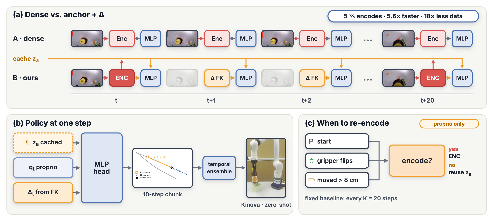

**Project page:** https://shureduan.github.io/Anchor_Delta/

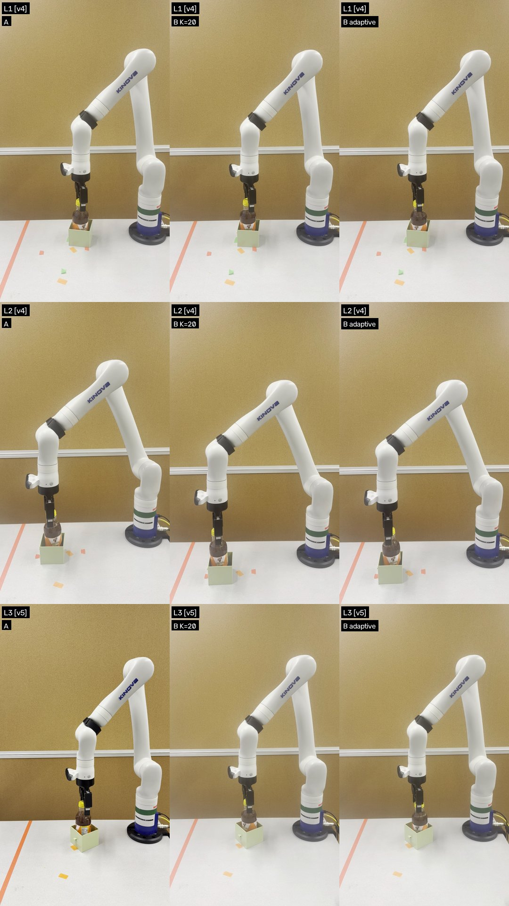

| | A dense | B fixed K=20 | B adaptive 8 cm |
|---|---|---|---|
| sim success, v5 (n = 30) | 29/30 | 30/30 | 30/30 |
| real 3x3 grid | 3/3 | 3/3 | 3/3 |
| real image encodes / episode | 191–209 (100 %) | 10–11 (5.1–5.4 %) | 10–12 (5.3–5.5 %) |
| real policy compute (idle M4 GPU) | 8.95–8.98 ms/step | 1.56–1.78 ms/step | 1.56–1.68 ms/step |
| real stored visual data / episode | 2.1–2.4 MB | 117–138 kB | 110–147 kB |

## Contents

| | |
|---|---|
| [1. Algorithm](report/01_algorithm.md) | network, A vs B inputs, delta, anchor rules, temporal ensembling, training, version history, SmolVLA line |
| [2. Simulation setup](report/02_simulation.md) | MuJoCo replica, scripted expert, randomisation, datasets, evaluation |
| [3. Real-robot setup](report/03_real_setup.md) | hardware, layouts, two-process runtime, safety, what is logged |
| [4. Results](report/04_results.md) | sim v2–v5, offline real-frame checks, real grid (success, encodes, compute, storage), conclusions, limitations |
| [5. Failure analysis](report/05_failure_analysis.md) | colour matching backfired; green-tape distractor; hidden-timer deadlock; re-opening after the grasp; v5 fixes |
| [6. Reproduce](report/06_reproduce.md) | code map, pipeline commands, data files |

## Media

**Real robot, third-person view** (phone, native aspect, 15x speed):

| | A dense | B fixed K=20 | B adaptive |
|---|---|---|---|
| L1 (v4) | 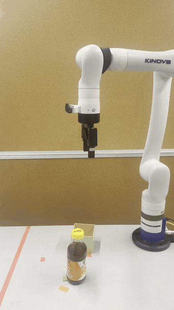 | 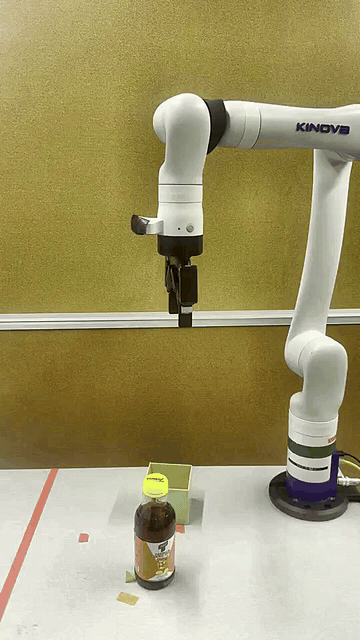 | 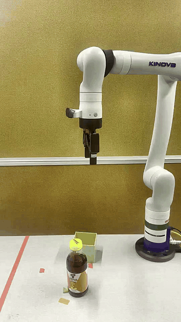 |
| L2 (v4) | 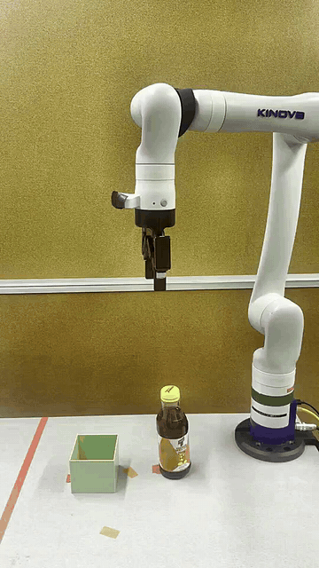 | 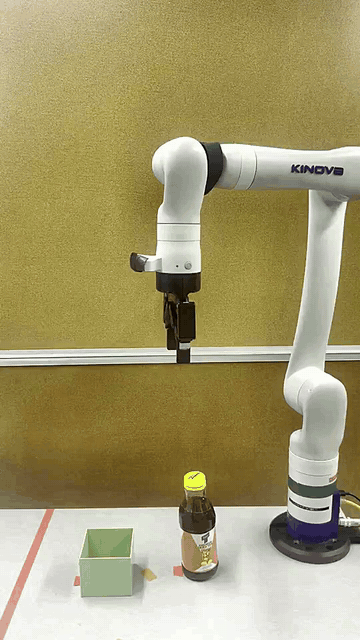 | 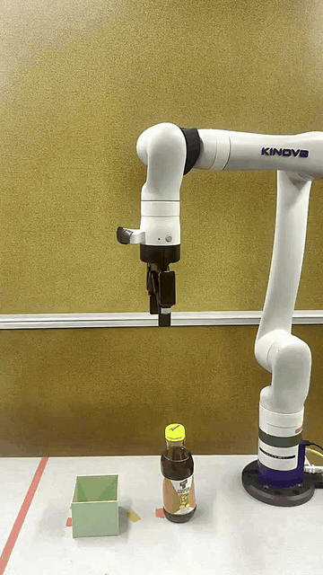 |
| L3 (v5) | 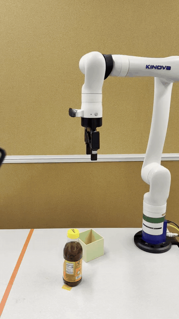 | 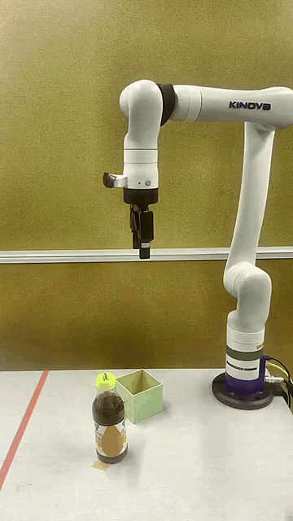 | 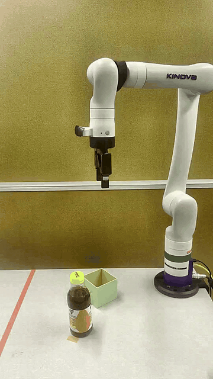 |

**Algorithm view of the same runs** (15x speed). Each shows the live wrist camera next to the image the policy uses (B: the frozen anchor), plus depth, the top-view path with the anchor, delta and 1 s plan, and the encode timelines:

| | A dense | B fixed K=20 | B adaptive |
|---|---|---|---|
| L1 (v4) | 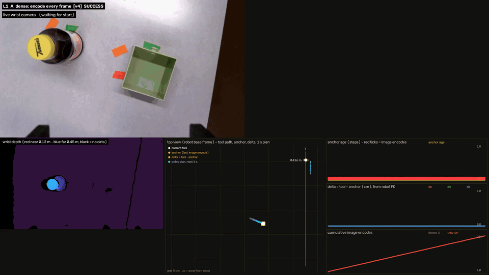 | 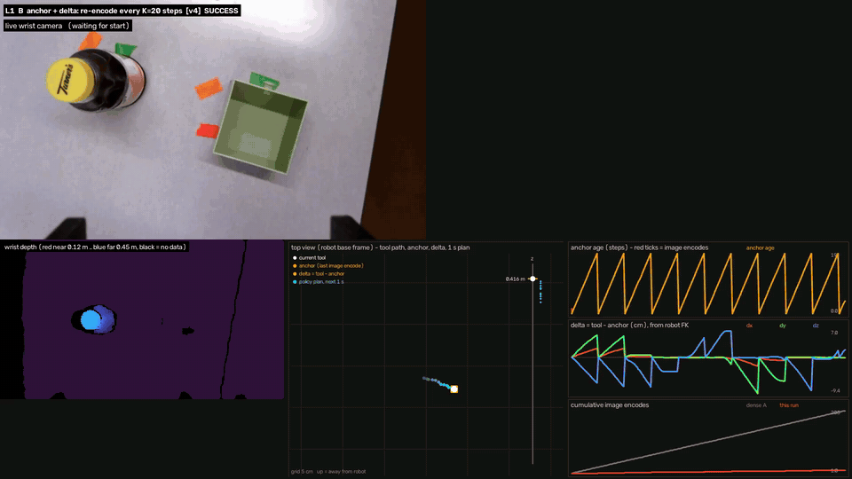 | 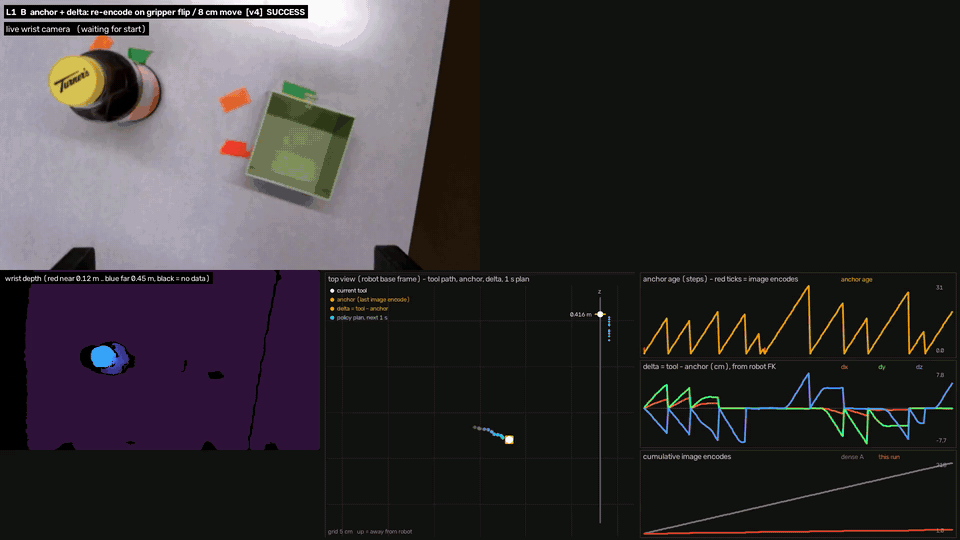 |
| L2 (v4) | 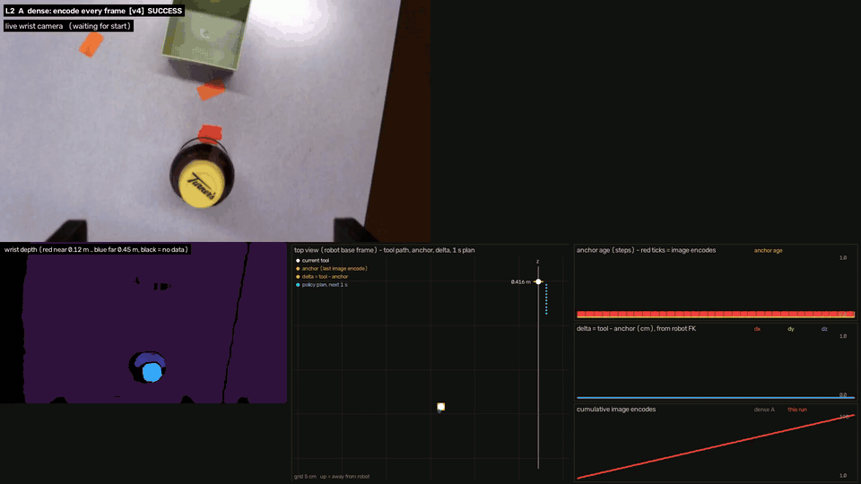 | 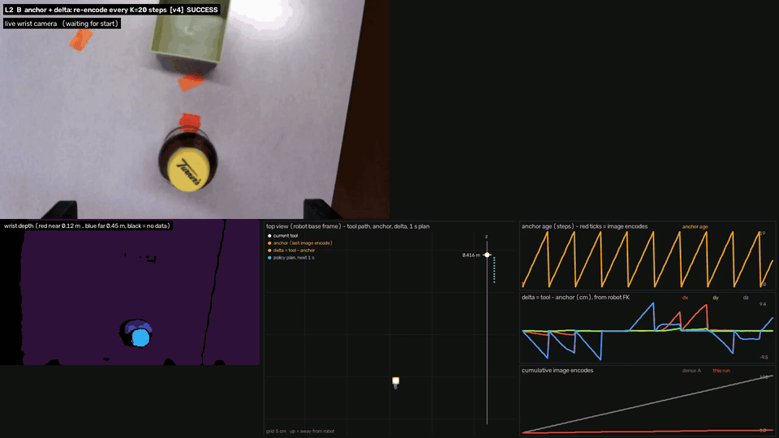 | 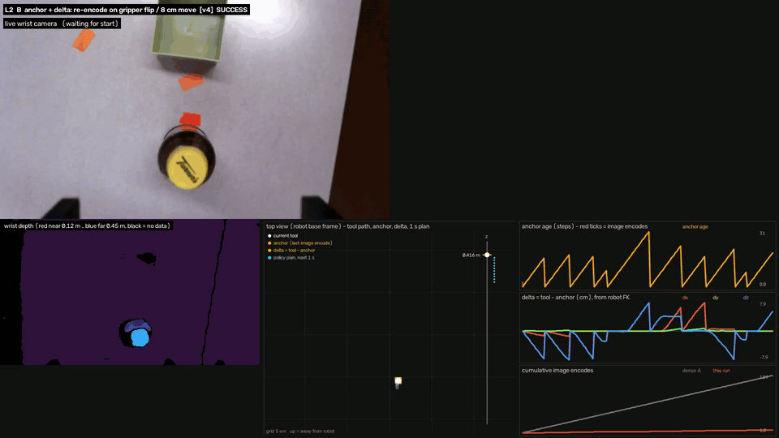 |
| L3 (v5) | 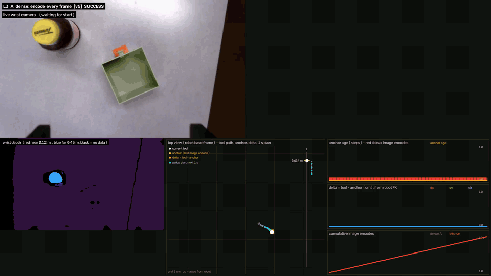 | 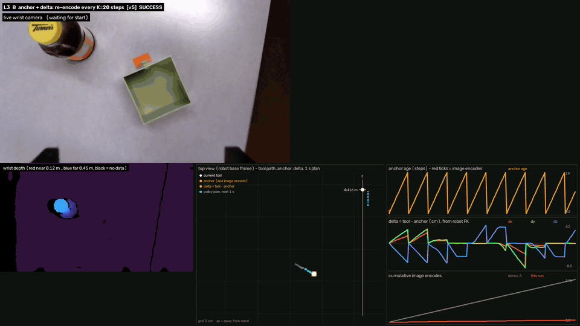 | 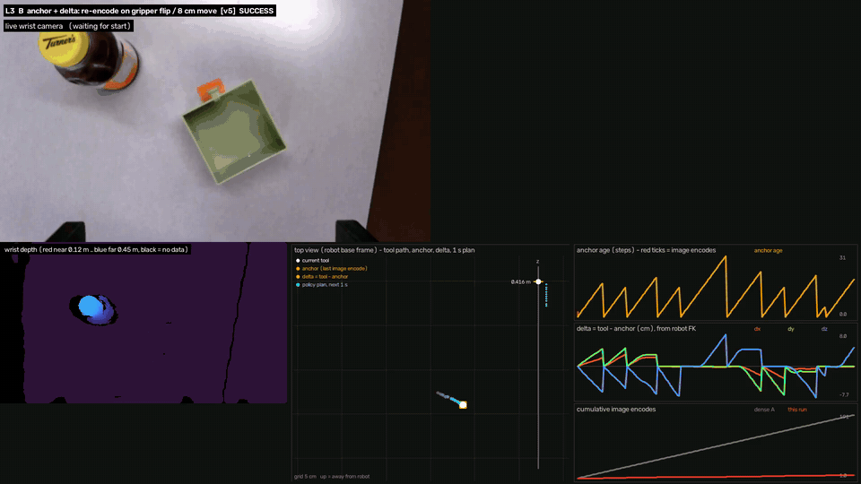 |

**Delta from kinematics, with RGB-D** (2x): 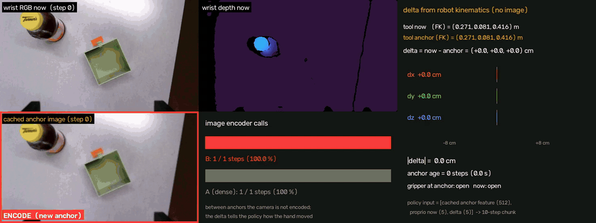

**When B takes a new anchor** (fixed vs adaptive, 2x): 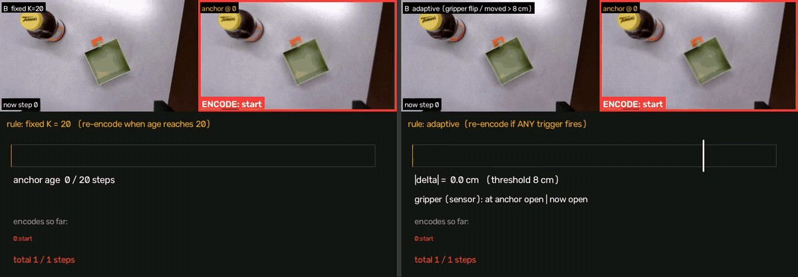

**Simulation** (A | B K=20 | B adaptive on the same scene, 3x): 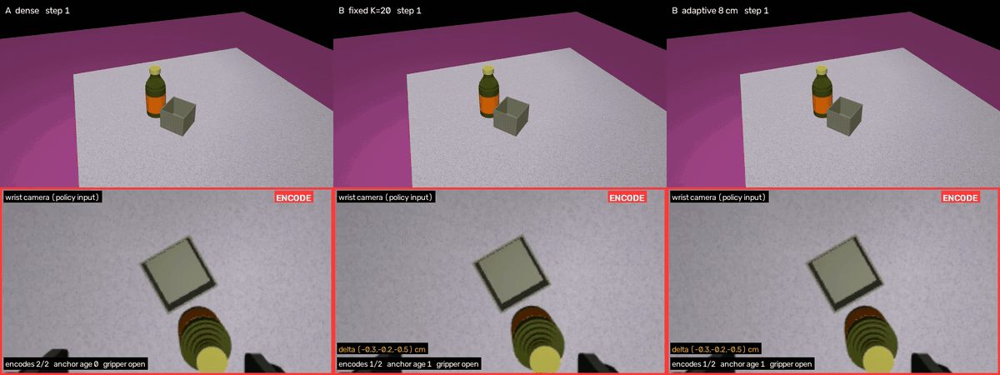

## Code

| folder | content |
|---|---|
| [`kinova_bottle_sim/`](kinova_bottle_sim/) | MuJoCo replica, scripted expert, appearance randomisation, A / B policies, training, evaluation, policy server, real-data analysis; simulation result files in `kinova_bottle_sim/out/` |
| [`delta_wristcam/real/`](delta_wristcam/real/) | real Kinova Gen3 scripts: connectivity, detection, scripted pick-and-place, policy client with safety limits and logging; camera calibration |
| [`viz/`](viz/) | per-frame visualisation of real runs, figures, simulation rollouts |

Datasets, model checkpoints and raw robot / phone recordings are not included because of their size.

Other material:
- Figures: `media/figures/`. Includes v4 vs v5 gripper analysis, per-phase real-frame agreement, real-grid cost, wrist RGB-D strips per run, and "what B sees".
- Still frames from the composite visualisation: `media/viz_stills/`.
- Run table: `data/real_runs.csv`.

## Status

The 3x3 real-robot grid currently uses the v4 models on layouts L1 and L2 and the v5 models on L3. Work in progress extends the v5 evaluation to all layouts with more trials per configuration.
