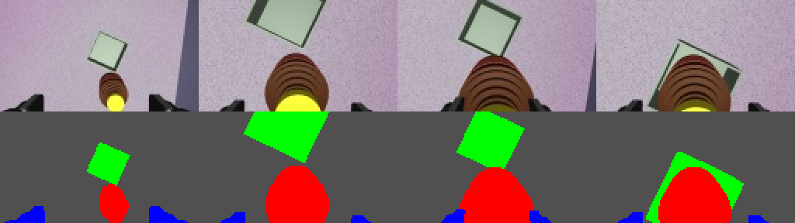
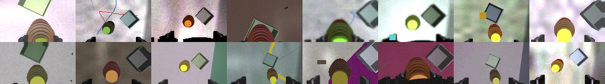

# 2. Simulation setup (`kinova_bottle_sim/`)

A MuJoCo replica of the real cell is used **only for training data and closed-loop evaluation**. The policies are then run on the real robot zero-shot.

## 2.1 Scene (`scripts/scene.py`)

| element | value (taken from the real robot) |
|---|---|
| world frame | Kinova base frame; table top z = -0.025 m (measured with the wrist depth camera) |
| hand | Kortex tool frame (Robotiq 2F-85, end-effector link + 0.12 m), driven by a mocap target through a weld. The action is the tool target xyz + gripper; orientation is fixed vertical, theta = (180, 0, 97.5) deg |
| gripper | mujoco_menagerie `robotiq_2f85` |
| wrist colour camera | pose from the Kinova URDF colour module, (0, 0.05639, -0.12305) m in the tool frame; real intrinsics 1280x720, fx 1297.7, fy 1298.6, cx 620.9, cy 238.3; rendered at 256x144 and resized to 128x72 with INTER_AREA, exactly like the real frames |
| objects | bottle 18.4 cm tall, body diameter 7 cm, cap diameter 3.6 cm; open box 8.7 cm square outside, 7.5 cm tall, 3 mm walls |
| appearance | look `real`: table and box colours sampled from real images |
| physics | MuJoCo 4.0.1, control at 10 Hz |

Check: the projection of the sim cap lands within 2 mm of the real one at the same tool pose.

## 2.2 Scripted expert (`scripts/expert.py`)

- Uses privileged object poses; the student never sees them.
- Same plan as the real scripted controller: above the cap → down to the grasp height (1.2 cm below the cap top) → close → lift → over the box → down to 2 cm above the rim → into the box → release → retreat.
- Streams 10 Hz targets at **5 cm/s** (≤ 5 mm per step).
- Noise in free-space phases only (0 / 0.5 / 1 cm, by seed), so the data contain recoveries. No noise near contacts, because the box has only 6 mm of clearance.
- **v5 (`--observable`)**: no hidden wait before a gripper change. v4 waited a fixed 0.3 s at a still pose, which nothing in the observation can time.
- Success = after release and 1 s of settling, the bottle base is inside the box's inner square and the bottle is upright (< 20 deg).

## 2.3 Randomisation per episode

- Bottle–box distance 10–20 cm, random box yaw.
- Start 40–46 cm above the table, looking at the midpoint ± 2.5 cm, tilt ± 1 deg.
- Material colours, light intensity and direction, camera mount ± 3 mm / ± 1 deg.
- Training-time class-map randomisation (`dr_aug.py`). The data store a per-pixel class map (0 background, 1 bottle, 2 box, 3 gripper) rendered by `Sim.render_seg`. It is used **only** to randomise appearance during training and is never a policy input.

## 2.4 Datasets

| dataset | episodes kept | frames | notes |
|---|---|---|---|
| `data/v4` | 496 / 500 | 100,667 | look `real`, class maps |
| `data/v5` | 494 / 500 | 97,313 | + observable expert |

## 2.5 Closed-loop evaluation (`scripts/eval.py`)

Unseen seeds 100000+. The A / B logic is identical to the real-robot controller. The episode ends 2 s after the first release that follows ≥ 1.5 s of holding. Reported per run: success with a Wilson 95 % interval, image encodes per step, and policy ms per step on the M4 GPU.
