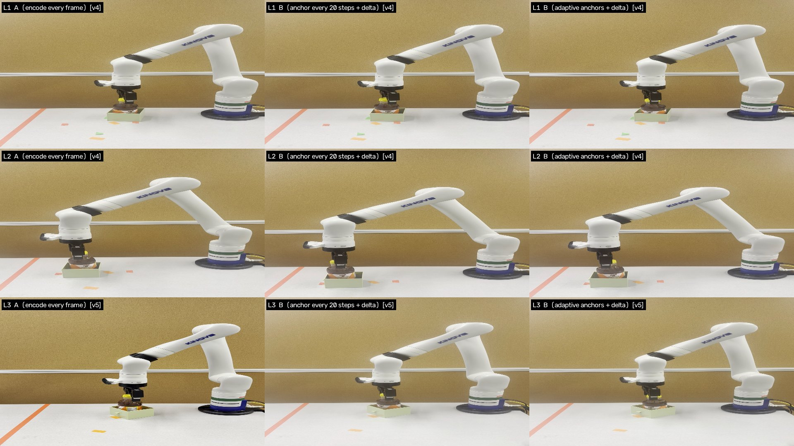

# 3. Real-robot setup (zero-shot)

## 3.1 Hardware and scene

| item | value |
|---|---|
| arm | Kinova Gen3 6-DoF, Robotiq 2F-85 gripper, tool frame + 0.12 m |
| wrist camera | Kinova vision module: colour 1280x720 (used at 640x360), depth 480x270 |
| task | pick the bottle by its 3.6 cm cap and put it into the open green box (8.7 cm square, 6 mm clearance per side) |
| layouts | L1 bottle left / box right; L2 bottle near the base / box far; L3 diagonal. midpoint roughly below the start pose, objects about 10–17 cm apart |
| start pose | tool (0.271, 0.081, 0.416) m, theta (180, 0, 97.5) deg, about 44 cm above the table |
| third-person video | phone, 1080p30. Synchronised to the robot clock by creation time, refined by correlating phone motion with the measured tool speed (r = 0.71–0.84) |



## 3.2 Software: two processes

```
policy_server.py  (kinova_bottle_sim/.venv: PyTorch, M4 GPU, 127.0.0.1:6001)
      ^  plain Python types + JPEG bytes
      v
21_policy_run.py  (conda env delta-kinova: Kortex API, no PyTorch)
   every 0.1 s: wrist colour frame + FK tool pose + gripper % -> server -> next tool target + gripper command
```

The real gripper reading is mapped to the sim reading linearly: 0.44 % → 0, 55.26 % (holding the cap) → 0.411.

## 3.3 Safety and execution

- Each step's target is clipped to ≤ 5 mm from the current tool and executed with ReachPose at ≤ 5 cm/s, gripper vertical.
- Workspace clamp: X [0.10, 0.55], Y [-0.25, 0.30], Z [0.145, 0.55] m.
- Confirmation: by default an empty Enter every ≤ 10 steps, and before every gripper change. With `--auto` (operator-approved, used for the videos) the episode runs without Enter; typing `q` stops at the next step. An operator is always present with a hand on the e-stop.
- **The gripper command waits until the fingers stop moving, with the arm held still.** Sending the next ReachPose immediately aborts the gripper motion; this is how the first run failed.
- The episode ends 20 steps after the first release that follows > 15 closed steps.

## 3.4 What is recorded per run (`delta_wristcam/real/out/demos/<stamp>/`)

| file | content |
|---|---|
| `episode.npz` | ~8 Hz wrist RGB (JPEG) + depth (mm), tool pose, joints, gripper %, step label, wall-clock time |
| `meta.json` | configuration, model checkpoint, result, operator note, and `policy_log` per step: wall times (frame capture / policy result / command / motion done), tool, target (raw and clipped), the 10-step plan, gripper logits, anchor step, anchor age, **delta**, encode flag, ms |
| `policy_frames.npz` | the exact 256x144 frame the policy received at every step |

Replaying `policy_frames` through the controller reproduces the logged anchor schedule exactly (`scripts/real_retime.py`). This is how compute is re-measured on an idle GPU.

## 3.5 Commands

```bash
# terminal 1
cd kinova_bottle_sim && .venv/bin/python scripts/policy_server.py --A runs/A5/last.pt --B runs/B5/last.pt
# terminal 2
conda activate delta-kinova && cd delta_wristcam
python real/scripts/13_goto.py 0.271 0.081 0.416          # rotate / move to the start pose (Enter)
python real/scripts/21_policy_run.py --policy B --rule fixed --K 20 --start 0.271 0.081 0.416 --z-min 0.145 --record --auto --note "L3 B5K20"
```
