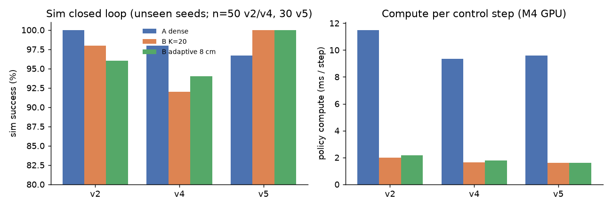
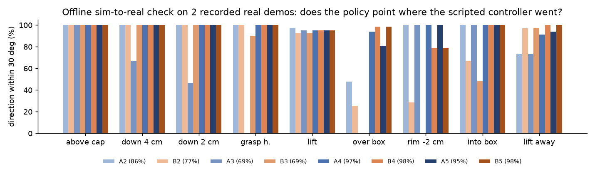
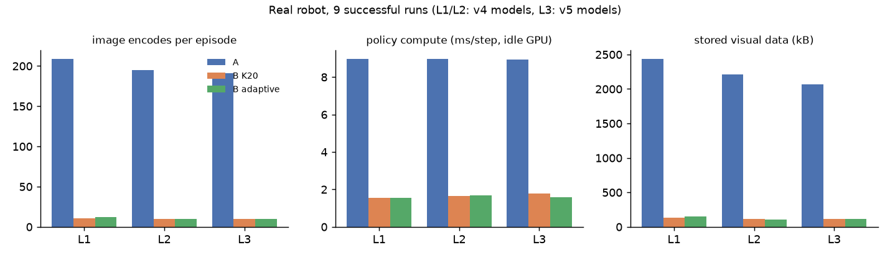

# 4. Results

## 4.1 Simulation, closed loop (unseen seeds, look `real` from v3 on)

| version | A dense | B fixed K=20 | B adaptive 8 cm | encodes / step (B) | ms / step A → B |
|---|---|---|---|---|---|
| v2 (n=50) | 50/50 | 49/50 | 48/50 | 0.052 / 0.050 | 11.5 → 2.0 |
| v4 (n=50) | 49/50 | 46/50 | 47/50 | 0.052 / 0.049 | 9.4 → 1.6 |
| **v5 (n=30)** | **29/30** | **30/30** | **30/30** | 0.053 / 0.051 | **9.6 → 1.6** |

Other results:
- v4 with a frozen ImageNet encoder (A4f) reached only 19/50, so the encoder has to be fine-tuned.
- B fixed-400 (one anchor at t = 0 only) succeeds 0/50, so anchors must be refreshed.

## 4.2 Offline sim-to-real check (no robot motion)

The policies were run on two recorded real demonstrations of the scripted controller. The metric is the fraction of frames, per phase, where the predicted 1 s displacement is within 30 deg of where the controller actually went.

| | A2 | B2 | A3 | B3 | A4 | B4 | A5 | B5 |
|---|---|---|---|---|---|---|---|---|
| overall | 86 % | 77 % | 69 % | 69 % | 97 % | 98 % | 95 % | 98 % |
| over the box | 48 % | 25 % | 0 % | 0 % | 94 % | 99 % | 81 % | 99 % |
| rim - 2 cm | 100 % | 29 % | 100 % | 0 % | 100 % | 79 % | 100 % | 79 % |

## 4.3 Real robot, zero-shot

### 3 x 3 grid of successful runs with full logs

L1 and L2 use the v4 models; L3 uses the v5 models. Compute was re-measured by replaying each run's exact inputs on an idle M4 GPU. Stored visual data = the policy-input JPEGs (256x144) a method must keep, plus 20 B/step of delta for B.

| layout | config | steps | image encodes | ms / step | stored visual data | vs dense |
|---|---|---|---|---|---|---|
| L1 | A | 209 | 209 | 8.98 | 2.44 MB | 1x |
| L1 | B K=20 | 205 | 11 | 1.56 | 138 kB | 18.1x less |
| L1 | B adaptive | 218 | 12 | 1.56 | 147 kB | 17.7x less |
| L2 | A | 195 | 195 | 8.97 | 2.22 MB | 1x |
| L2 | B K=20 | 190 | 10 | 1.65 | 118 kB | 18.4x less |
| L2 | B adaptive | 189 | 10 | 1.68 | 110 kB | 18.3x less |
| L3 | A (v5) | 191 | 191 | 8.95 | 2.06 MB | 1x |
| L3 | B K=20 (v5) | 191 | 10 | 1.78 | 117 kB | 18.6x less |
| L3 | B adaptive (v5) | 191 | 10 | 1.59 | 118 kB | 18.6x less |

**B uses 5.1–5.9 % of the image encodes, is 5.0–5.8x cheaper per control step, and stores ~18x less visual data, while completing the same task.**

### All valid real runs on 2026-11-22

Runs excluded from this count: one executor bug, two runs with a green-tape distractor, one executor experiment, and two operator stops. Details are in `data/real_runs.csv`.

| model | A | B K=20 | B adaptive |
|---|---|---|---|
| v4 (L1–L3) | 5/6 | 4/6 | 4/5 |
| v5 (L3) | 1/1 | 1/1 | 1/1 |

Every valid v4 failure is one of the two gripper problems analysed in [failure analysis](05_failure_analysis.md). Both are fixed in v5, which so far is 3/3 on the layout where v4 failed.

## 4.4 Conclusions

1. **Anchor + delta works on the real robot.** With about 1 image encode per 20 control steps, B completed the same pick-and-place as dense encoding, at about 1/5 of the policy compute and 1/18 of the visual data. The delta comes purely from robot FK and the gripper sensor.
2. **Encoding fewer images did not lose information**, as long as anchors are refreshed (fixed-400 fails) and B is trained with mixed anchor ages so it cannot use the age as a clock.
3. **In this study the sim-to-real gap was about appearance and observability, not geometry.** Matching colours backfired (v3). Class-map-driven randomisation fixed the transfer phase (v4). The remaining real failures came from gripper decisions tied to appearance and to an expert timer the policy could not observe (fixed in v5).
4. **The benefit depends on where the compute goes.** It is large for an image-encoder-dominated policy (ResNet: 5–6x) and small for a diffusion / flow VLA whose denoising dominates (SmolVLA: ≤ 1.24x).

## 4.5 Limitations (honest status)

- Real sample sizes are small (3 layouts; 1–6 runs per cell), with one training seed per model.
- The 3 x 3 grid mixes v4 (L1, L2) and v5 (L3); v5 still needs runs on L1 and L2.
- The offline check uses only 2 recorded demonstrations.
- The start pose is fixed, and the object layouts stay inside the training distribution. Out-of-distribution layouts and distractors are not yet tested systematically; one green-tape distractor did break v4.
- Storage counts policy-input JPEGs (256x144, q95), not raw sensor video.
