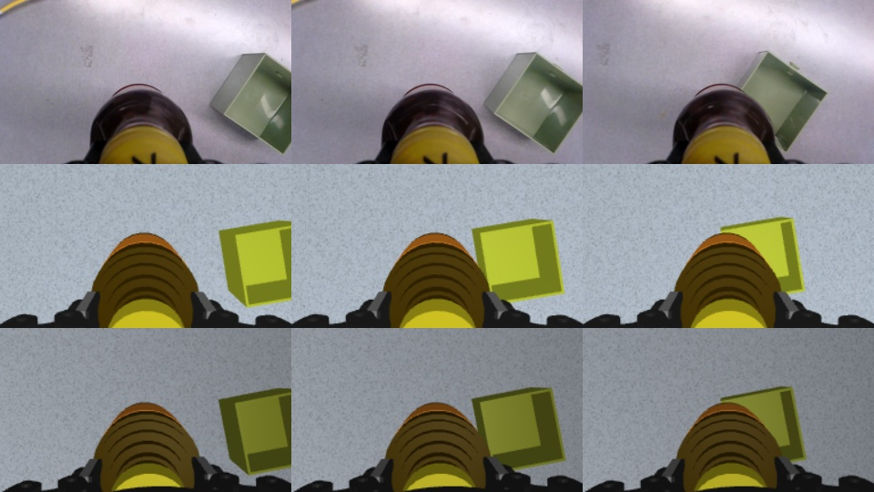
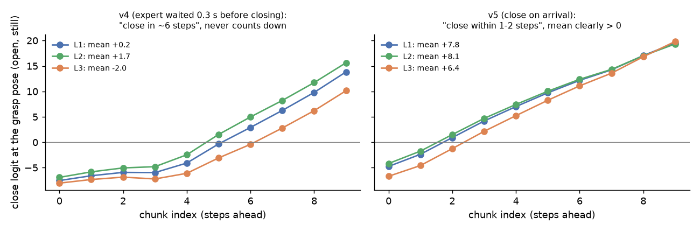
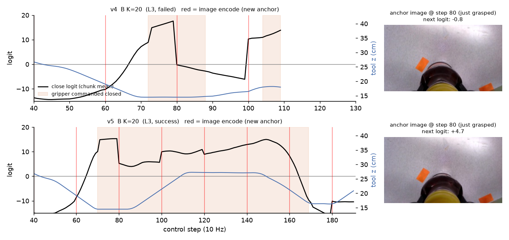

# 5. Failure analysis: what broke, why, and what fixed it

Every failure was diagnosed from the logs and from controlled tests on real frames. None was fixed by hand-tuned control rules. One such rule was tried, the gripper "commit" rule, and was withdrawn because it masked the cause.

## 5.1 Matching colours made sim-to-real worse (v3)

v2 failed to steer to the box on real frames. "Over the box" agreement was 48 % for A2 and 25 % for B2, and the sim box was bright lime while the real box is sage. Re-colouring the sim scene (v3) made agreement **worse**: 69 % overall, and 0 % over the box.

**Region-swap test.** Pasting the real *box* region into sim frames kept the policy correct (84–88 %). Pasting the real *table/background* or the real *held bottle* broke it. So the gap was the background and the held bottle, not the box colour.

**Fix (v4).** Per-pixel class maps from the simulator drive training-time randomisation: random table textures with glare, cables, stains and edges, and separate colour gains for the bottle, box and gripper. Real-frame agreement rose to 97–98 %.

## 5.2 Executor bug: gripper command aborted

The first real run reached the cap but the fingers stopped at 5 %. Kortex aborts a running gripper motion when the next ReachPose arrives 0.1 s later.

**Fix.** Send the gripper command, hold the arm, and wait until the fingers stop. The sim expert also holds still while closing.

## 5.3 Distractor: green marker tape next to the bottle

On L3 a saturated green tape strip sat beside the bottle, and A4 hovered 5 cm above the cap. In an occlusion sweep over a 4 x 8 grid on the real frame, **only the cell containing the tape** switched the plan from "go up" to "go down". The policy read green-near-the-bottle as box-like.

**Fix.** Pencil marks instead of tape for the runs. Robustness to box-coloured distractors is open work.

## 5.4 Hidden timer: the policy never decides to close (v4)

The v4 expert reached the grasp pose and then **waited a fixed 0.3 s** before closing. During that wait the image and the proprioception are constant. The "steps since the gripper changed" input is already saturated, because sim closes happen at steps 61–74 and the cap is 50. Nothing in the observation can time the wait. The policy therefore learned a stationary belief, *"close in about 6 steps"*, that never counts down.

Under uniform temporal ensembling the gripper closes only if the mean logit of that chunk is > 0. On real frames it was +0.2 (L1) and +1.7 (L2), which closed by luck, and **-2.0 (L3)**, which waited forever.

**Fix (v5).** The expert closes and releases **on arrival**, so the gripper command is a function of what the policy can observe. The v5 policy says "close within 1–2 steps" with a mean of +6.4 to +8.1 on the same real frames.

## 5.5 Re-opening after the grasp (v4): the gripper state was read from appearance

Several v4 runs grasped the cap and then opened again. The B logs show the mechanism clearly. While the cached anchor was a pre-grasp frame, the close logit was +15. The first anchor encoded *after* the grasp (step 80) dropped it to -0.8, and the gripper opened.

Controlled tests on that real frame showed two things:
- The v4 gripper output barely depends on the gripper **sensor** input; feeding "open" or "closed" changes it little.
- It follows the **image**: the sim just-grasped image gives +9, the real one gives -3.5 (A4) or -5.8 (B4).

The real wrist view of a held cap looks unlike the sim view, where the dark fingers are prominent and the bottle is ridged brown. A therefore sees this every step; B sees it whenever an anchor falls after the grasp, which explains the run-to-run variability.

**Fix (v5).** During training the gripper fingers are erased (p = 0.5, using the class map), so the gripper state must come from the sensor, and the held bottle gets random textures (p = 0.5). On the same real frames the v5 post-grasp logits are +7.6 to +8.7 (A5) and +0.9 to +6.2 (B5). On the real robot, all three v5 configurations completed L3 cleanly: one close and one release each.

## 5.6 Acceptance test kept for future models

`kinova_bottle_sim/scripts/real_grip_check.py` evaluates a checkpoint on these real frames. The close logit at the grasp pose and the hold logit after the grasp must both be clearly > 0.
